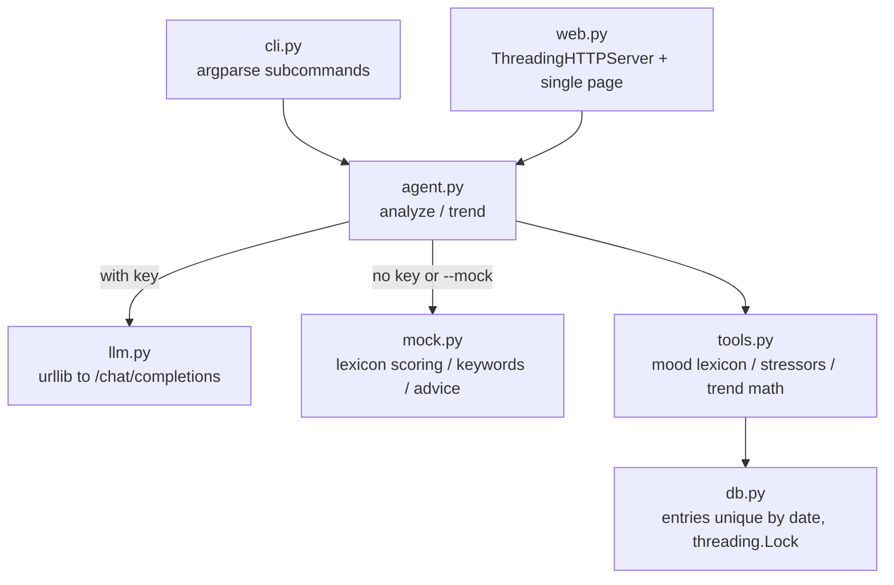

# xinyu (Inner Voice)

[](https://github.com/wushiyi105-jpg/xinyu/actions)
[]()
[](./LICENSE)
[](https://codecov.io/gh/wushiyi105-jpg/xinyu)


Write a paragraph a day, get a mood score, find what is draining you, and watch the trend over time.

I did not build this to "manage emotions". The real reason: I often feel "I have been off lately" but cannot say which day it started or what dragged me down. xinyu does three verifiable things — **score the words you actually wrote, tie each stressor to a specific sentence, and compute the mean and volatility over a period**.

## Features

- **One entry per day**: keyed by date; writing again the same day overwrites, no duplicate rows.
- **Mood scoring**: lexicon-based, range -5 to 5. The model can name the mood more vividly, but an out-of-range score is clamped.
- **Stressors with evidence**: every stressor must quote a sentence from the entry; if the quote cannot be found it is dropped — no "you seem stressed lately" guesses.
- **Actionable advice**: at most 4 items, each under 40 characters, concrete enough to do. No diagnosis, no medication talk.
- **Trend**: mean, volatility (standard deviation), best and hardest day, longest low streak — all computed locally. The model only writes a short reading, and may not introduce numbers absent from the stats.
- **Offline mode**: lexicon + keywords + tiered advice, clearly labelled "based only on what you wrote, no inference".
- **Two entry points**: CLI and web page, data stays local.

## Quick start

```bash
git clone https://github.com/wushiyi105-jpg/xinyu.git
cd xinyu
python -m xinyu add today.txt --date 2026-11-25
python -m xinyu analyze 2026-11-25
python -m xinyu trend --days 7
```

Connect a model:

```bash
cp .env.example .env
# fill LLM_API_KEY; defaults to https://api.deepseek.com + deepseek-flash
```

```bash
LLM_BASE_URL=https://open.bigmodel.cn/api/paas/v4 LLM_MODEL=glm-4.6 python -m xinyu analyze 2026-11-25
```

Web:

```bash
python -m xinyu web --port 8768
# http://127.0.0.1:8768
```

## Command reference

| Command | What it does |
| --- | --- |
| `add <file> [--date]` | Add an entry; `-` reads stdin; defaults to today |
| `list [--limit]` | Recent entries |
| `show <date or id>` | Full entry and its analysis |
| `analyze <date or id>` | Analyze and store |
| `trend [--days 7]` | Trend |
| `rm <key>` / `stats` | Delete / stats |
| `web` | Web UI |

Global switches `--mock`, `--json`, `--model`, `--base-url`, `--api-key`, `--db` work anywhere.

## How it works



Three decisions:

1. **Scores and arithmetic are not the model's to change.** Word tendencies, means and standard deviations are computable; the model names the mood and humanises the stressors. An out-of-range score is clamped, and a trend summary with numbers outside the stats falls back to the local reading.
2. **Evidence must be verifiable.** Whichever sentence matched a stressor keyword is copied verbatim; if it cannot be copied, the model invented it and the item is dropped.
3. **No diagnosis, no pretend doctor.** Advice is actions only (walk, split tasks, write it down), and it never claims to replace professional help.

Storage is one SQLite file with `check_same_thread=False` plus a `threading.Lock`; default `data/xinyu.db`, overridable with `XINYU_DB`.

## Layout

```
xinyu/
├── xinyu/
│   ├── __init__.py / __main__.py
│   ├── llm.py     # OpenAI-compatible client + .env loader
│   ├── db.py      # entries (unique by date, thread-safe)
│   ├── tools.py   # mood lexicon, stressors, trend math, quote check
│   ├── mock.py    # offline analysis and trend text
│   ├── agent.py   # analysis and trend orchestration
│   ├── cli.py     # command line
│   └── web.py     # web UI
├── data/entries-sample.json
├── tests/test_xinyu.py
├── assets/demo.gif
├── .github/workflows/test.yml
├── pyproject.toml
├── README.md / README.en.md
└── CHANGELOG.md / SECURITY.md / CODE_OF_CONDUCT.md / CONTRIBUTING.md
```

## Author

shiyi · GitHub [@wushiyi105-jpg](https://github.com/wushiyi105-jpg) · wushiyi105@gmail.com

MIT License, Copyright (c) 2026 wushiyi105-jpg
