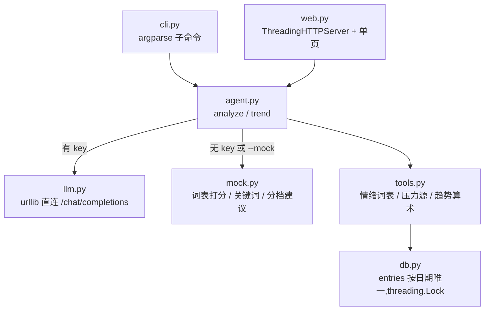

# 心语 xinyu

[](https://github.com/wushiyi105-jpg/xinyu/actions)
[]()
[](./LICENSE)
[](https://codecov.io/gh/wushiyi105-jpg/xinyu)


每天写一段,给情绪打个分,找出压力源头,再看这段时间的走势。

我做这个不是为了"管理情绪"这种虚话。真实的原因是:我经常觉得自己"最近状态不好",但说不出从哪天开始、被什么拖下去的。心语只做三件能验证的事——**给你写下的字打分、把压力源对应到具体那句话、把一段时间的均值与波动算给你看**。

## 功能特性

- **每日一条**:按日期存,同一天再记就覆盖,不留重复行。
- **情绪打分**:词表打分,范围 -5 到 5;模型可以给更具象的情绪名,但分数越界会被截断。
- **压力源带证据**:每个压力源必须附一句原文,查不到就丢——避免"可能你最近压力大"这类没法核对的判断。
- **建议可执行**:最多 4 条,每条不超过 40 字,要具体到动作。不做诊断、不提药物。
- **趋势**:均值、波动(标准差)、最好/最难的一天、连续低落天数,全部本地算;模型只写一段解读,并禁止出现统计里没有的数字。
- **离线模式**:词表 + 关键词 + 分档建议,明说"只基于你写下的字,不做推断"。
- **双入口**:CLI 与网页,数据都在本机。

## 快速开始

```bash
git clone https://github.com/wushiyi105-jpg/xinyu.git
cd xinyu
python -m xinyu add today.txt --date 2026-11-25
python -m xinyu analyze 2026-11-25
python -m xinyu trend --days 7
```

接模型:

```bash
cp .env.example .env
# 填 LLM_API_KEY,默认 https://api.deepseek.com + deepseek-flash
```

```bash
LLM_BASE_URL=https://open.bigmodel.cn/api/paas/v4 LLM_MODEL=glm-4.6 python -m xinyu analyze 2026-11-25
```

网页:

```bash
python -m xinyu web --port 8768
# http://127.0.0.1:8768
```

Docker 运行(容器内用默认端口 8000):

```bash
docker build -t xinyu .
docker run -p 8000:8000 xinyu
```

## 命令参考

| 命令 | 作用 |
| --- | --- |
| `add <file> [--date]` | 记一条,`-` 从 stdin 读,默认今天 |
| `list [--limit]` | 最近记录 |
| `show <日期或 id>` | 看某一天的全文与分析 |
| `analyze <日期或 id>` | 分析并存库 |
| `trend [--days 7]` | 趋势 |
| `rm <key>` / `stats` | 删除 / 统计 |
| `web` | Web UI |

全局开关 `--mock`、`--json`、`--model`、`--base-url`、`--api-key`、`--db`,前后都能放。

## 🤔 为什么不用通用大模型直接问

通用模型读完你的一段心情能安慰得很好,但心语补的是它做不到的四个字:有据可查。

1. **证据要能回查** —— 模型说「你今天压力主要来自工作」,必须同时给出一句你写过的原话,程序逐字比对,对不上就丢。通用模型的共情很顺,但你分不清它是读懂了,还是在套模板。
2. **趋势本地算** —— 平均分、波动、连续低落天数都由本地统计算,模型只写一段话,且不许引用统计之外的数字;同一批记录算两次,结论一致。
3. **日记留在本地** —— 情绪记录是最私人的东西之一,存在本地 SQLite,不上传;调模型时只发当天这一段。
4. **离线能记能看** —— 没 key 时用词表打分、给模板建议,趋势照算;要更细的解读才需要模型。

## 🎯 适用场景

- **每天睡前写三行**:今天什么事、什么感觉、打几分;一周后回头看,知道自己哪天最差、因为什么。
- **月度回顾**:看均值、波动和连续低落段,判断是「这周确实难」还是「一直没缓过来」。
- **说不清自己怎么了的时候**:写下来让它指出压力源,对照它引用的原话,常常比自己反复想更清楚。

## 🗺 Roadmap

- **情绪与事件标签**:给记录打「工作/家人/身体」标签,趋势能按标签拆开看。
- **周报**:每周生成一页回顾,含最好最差的一天与变化原因。
- **温和提醒**:连续 N 天低分时提醒一次,而不是每天弹。
- **导出**:把自己的记录导成 Markdown,需要时带给咨询师看。
- **与梦记联动**:睡眠与情绪放在一张时间线上看,找出互相影响的段落。

## ❓ FAQ

**API key 从哪来?**
项目不带 key。默认接 DeepSeek(`https://api.deepseek.com`),注册后填 `LLM_API_KEY`;也可换任何 OpenAI 兼容端点。

**数据存在哪,会上传吗?**
情绪记录在本地 SQLite(默认 `data/xinyu.db`);调模型时只发当天这一段文字,不发历史。

**没有 key 能不能用?**
能记录、能看趋势,分析用本地词表打分加模板建议;没有模型那层更细的解读。

**怎么换模型?**
改 `LLM_BASE_URL`、`LLM_MODEL`、`LLM_API_KEY`,或用 `--model` 覆盖。

**它是心理医生吗?**
不是。它做的是把你说过的话整理清楚、指出可能的压力源;持续的严重情绪问题该找专业的人,它会在需要时提示。

## 工作原理



三处取舍:

1. **分数与算术不给模型改**。情绪词的倾向和均值、标准差是能算的;模型负责给情绪起名、把压力源说成人话,但 `score` 越界直接截断,趋势总结里冒出统计外的数字就换回本地解读。
2. **证据必须能回查**。压力源的关键词命中了哪句,就把那句原样抄出来;抄不出来说明是模型自己编的,直接丢。
3. **不做诊断,也不装医生**。建议只给动作(散步、拆任务、写下来),不说"你应该去看心理医生"以外的医疗判断;真需要专业帮助,它也不会假装能替代。

SQLite 单文件,`check_same_thread=False` + `threading.Lock`,默认 `data/xinyu.db`,`XINYU_DB` 可改。

## 目录结构

```
xinyu/
├── xinyu/
│   ├── __init__.py / __main__.py
│   ├── llm.py     # OpenAI 兼容客户端 + .env 加载
│   ├── db.py      # entries(日期唯一,线程安全)
│   ├── tools.py   # 情绪词表、压力源、趋势算术、证据回查
│   ├── mock.py    # 离线分析与趋势文案
│   ├── agent.py   # 分析与趋势编排
│   ├── cli.py     # 命令行
│   └── web.py     # Web UI
├── data/entries-sample.json
├── tests/test_xinyu.py
├── assets/demo.gif
├── .github/workflows/test.yml
├── pyproject.toml
├── README.md / README.en.md
└── CHANGELOG.md / SECURITY.md / CODE_OF_CONDUCT.md / CONTRIBUTING.md
```

## 作者

小米 · 17612850106

MIT License,Copyright (c) 2026 wushiyi105-jpg
